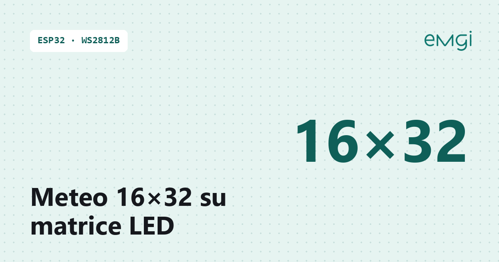
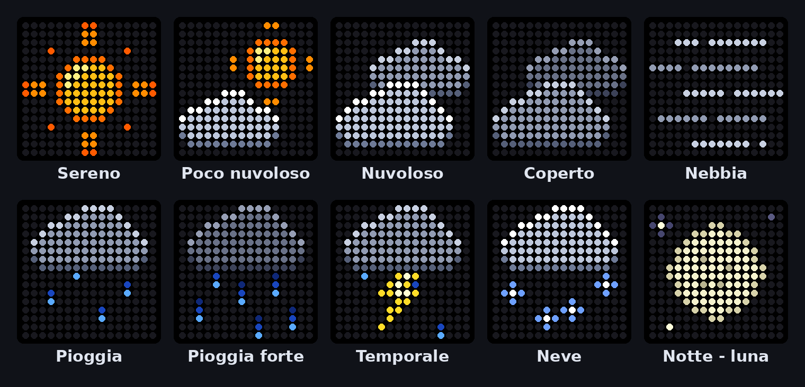

# Meteo 16×32 con ESP32 e WS2812B

> 📖 **Articolo completo con schema, foto e spiegazioni passo passo:**  
> **[Meteo 16×32 con ESP32 e WS2812B – www.emgi.it](https://www.emgi.it/2026/04/03/meteo-16x32-con-esp32-e-ws2812b/)**
>
> Altri progetti di elettronica, Arduino, ESP32, Home Assistant e stampa 3D su **[www.emgi.it](https://www.emgi.it)**

In questo progetto ho realizzato un pannello meteo basato su ESP32 WROOM32 e due matrici LED WS2812B da 8×32 pixel, impilate per ottenere un display finale da 16×32 pixel.

Il sistema mostra icona meteo animata, temperatura e umidità, aggiornate tramite OpenWeather e sincronizzate con NTP. Tutto è gestibile da una pagina web in italiano con aggiornamenti in tempo reale, senza ricaricare la pagina.

## Caratteristiche

- ESP32 WROOM32
- 2 pannelli WS2812B 8×32, matrice totale 16×32
- Mapping serpentina verticale, primo pixel in alto a sinistra
- Meteo via OpenWeather (coordinate GPS)
- Ora via NTP con ora legale automatica
- Icone meteo pixel-art 16×16 animate (8 passi), con varianti notturne
- Luna con la fase reale, calcolata sul ciclo lunare
- Ultimo dato meteo mantenuto se la connessione cade
- Web server in tempo reale (senza ricaricare la pagina)
- Modalità notte con luminosità e colori attenuati
- Riavvio automatico programmabile
- Impostazioni salvate in memoria (NVS)
- Aggiornamento OTA da Arduino IDE
- Indirizzo con nome: meteo16x32.local
- Messaggi di diagnostica sulla seriale (115200 baud)

## Materiale

Materiale utilizzato

- ESP32 WROOM32
- 2 × matrici WS2812B 8×32
- Alimentatore 5V
- Cavi dupont
- (opzionale) case stampato 3D

## Collegamenti elettrici

Scheda: **ESP32** (Dev Module). Pin verificato sullo sketch (`DATA_PIN = 5`, FastLED, 512 LED WS2812B = due pannelli 8×32 in cascata).

| Da | A |
|---|---|
| ESP32 **GPIO 5** | **DIN** del primo pannello (consigliata resistenza **330–470 Ω** in serie) |
| **DOUT** primo pannello | **DIN** secondo pannello |
| Alimentatore **+5V** | **5V** di entrambi i pannelli (iniettare l'alimentazione su ogni pannello) |
| Alimentatore **GND** | **GND** di entrambi i pannelli **e GND dell'ESP32** |
| Alimentatore +5V | **5V/VIN** dell'ESP32 (oppure alimenta l'ESP32 da USB) |

- La **massa deve essere comune** tra ESP32, pannelli e alimentatore, altrimenti il segnale dati non funziona.
- Mappatura: serpentina verticale, pannello inferiore ruotato di 180° (vedi la funzione di mapping nello sketch).
- Alimentatore 5 V da almeno **2,5–3 A** (lo sketch limita il consumo della matrice a 2 A con `PSU_MAX_MA`) e condensatore da **1000 µF** tra 5V e GND vicino ai pannelli. Non alimentare la matrice dal pin 5V dell'ESP32.

## Contenuto del repository

| Percorso | Descrizione |
|---|---|
| `Meteo_16x32/Meteo_16x32.ino` | Sketch Arduino |
| `immagini/` | Foto e immagini dell'articolo |

## Come si usa

1. Apri [`Meteo_16x32/Meteo_16x32.ino`](Meteo_16x32/Meteo_16x32.ino) con Arduino IDE.
2. Inserisci SSID, password WiFi, **API key OpenWeather** (gratuita) e le coordinate della tua città.
3. Tools → Partition Scheme → **Default 4MB with spiffs**.
4. Dopo il primo caricamento via USB puoi aggiornare via rete (porta `Meteo16x32`).

Schema dei collegamenti, dettagli e risoluzione dei problemi: **[articolo su www.emgi.it](https://www.emgi.it/2026/04/03/meteo-16x32-con-esp32-e-ws2812b/)**.

## Immagini

## Licenza

- Codice e configurazioni: [MIT](LICENSE)
- Modelli 3D, schemi e immagini: [CC BY-SA 4.0](https://creativecommons.org/licenses/by-sa/4.0/deed.it)

---

**Autore:** Massimiliano Sandrin – **[eMGi.it](https://www.emgi.it)** · Domande e commenti sotto l'[articolo sul sito](https://www.emgi.it/2026/04/03/meteo-16x32-con-esp32-e-ws2812b/).
